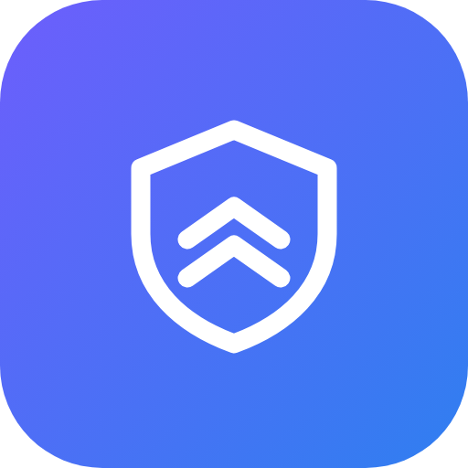
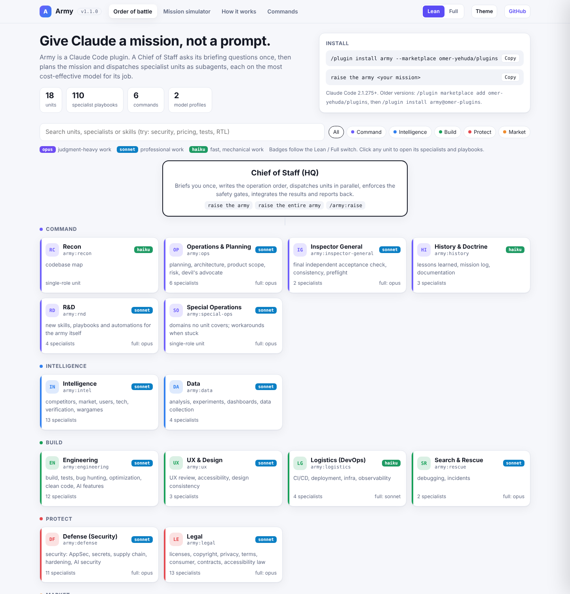
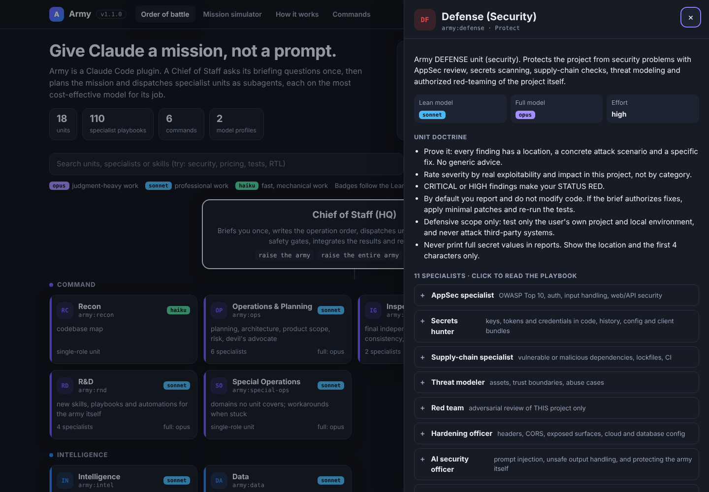
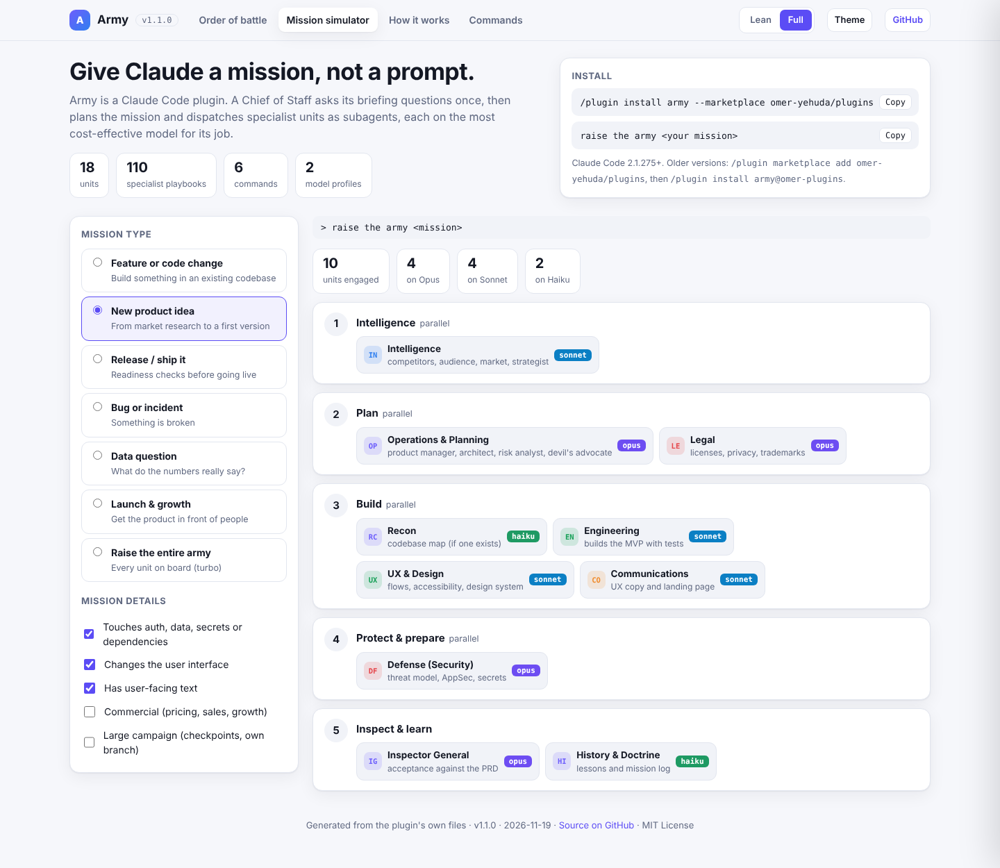
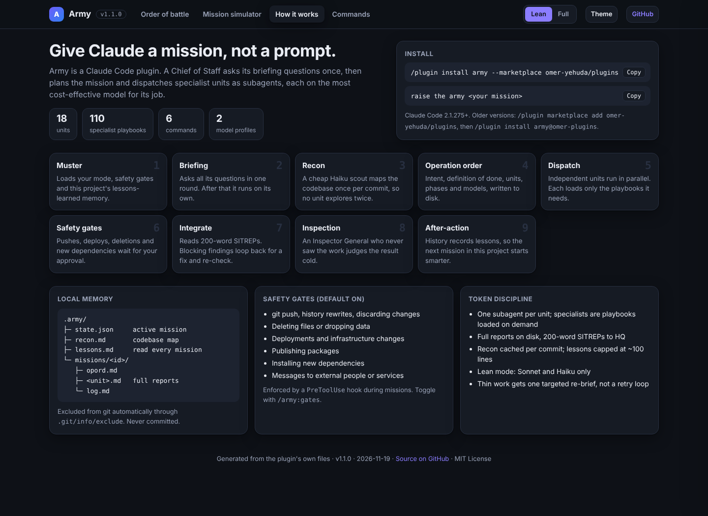

<div align="center">



# Omer Yehuda · Claude Code Plugins

**A curated marketplace of production-grade plugins for [Claude Code](https://code.claude.com).**

[](https://github.com/omer-yehuda/plugins/actions/workflows/validate.yml)
[](LICENSE)


**[Live interactive map](https://omer-yehuda.github.io/plugins/)** · [Mission simulator](https://omer-yehuda.github.io/plugins/#simulator) · [How it works](https://omer-yehuda.github.io/plugins/#how)

</div>

---

## Quick start

Run this in Claude Code (v2.1.275 or later):

```
/plugin install army --marketplace omer-yehuda/plugins
```

<details>
<summary>Older Claude Code versions</summary>

```
/plugin marketplace add omer-yehuda/plugins
/plugin install army@omer-plugins
```
</details>

Restart Claude Code (or run `/reload-plugins`), then type:

```
raise the army build a landing page for my habit-tracking app
```

To update later, run `/plugin marketplace update omer-plugins`.

## Plugin catalog

| Plugin | What it does | Version |
|---|---|---|
| [**army**](plugins/army/README.md) | Multi-agent orchestration. A Chief of Staff commands 18 specialist units (intel, engineering, defense, legal, comms, data, sales and more) as subagents, backed by 110 on-demand specialist playbooks. Includes cost-aware model routing, safety gates and local lessons-learned memory. | 1.1.0 |

---

## Featured: Army

> Give Claude a mission, not a prompt.

Say **"raise the army"** and Claude becomes a Chief of Staff. It asks its briefing questions once, writes an operation order, and dispatches specialist units in parallel, each on the most cost-effective model for its job. An independent Inspector General checks the result against your requirements before anything is reported back.


### See it

| | |
|---|---|
| [](https://omer-yehuda.github.io/plugins/) | [](https://omer-yehuda.github.io/plugins/?unit=defense) |
| **Order of battle:** all 18 units, with the model badges following the Lean/Full switch | **Unit drawer:** doctrine and every specialist playbook, readable in place |
| [](https://omer-yehuda.github.io/plugins/#simulator) | [](https://omer-yehuda.github.io/plugins/#how) |
| **Mission simulator:** pick a mission type and see which units engage, in which phase, on which model | **How it works:** the 9-step mission flow, memory, safety gates and token discipline |

### Highlights

- **18 specialist units, 110 specialist playbooks:**
  - Research: competitor research, verification and wargames.
  - Code: bug hunting, unit and E2E testing, AI feature engineering.
  - Security: OWASP review, secrets scanning, hardening and AI security.
  - Legal: OSS licenses, privacy law, consumer law and contract review.
  - Text: UX copy and Hebrew/RTL localization.
  - Operations and market: CI/CD, SEO/ASO, data analysis, sales and support.
- **Self-improving:** the R&D unit proposes new skills and playbooks from recurring lessons, and you approve every change.
- **Cost-aware model routing:** a `lean` profile for the Pro plan (Sonnet and Haiku only) and a `full` profile for the Max plan (Opus for critical units). Switch with `/army:mode`.
- **Token discipline by design:** units write full reports to disk and return SITREPs of at most 200 words. The codebase map is cached per commit, and playbooks load only on demand.
- **Safety gates:** during a mission, a `PreToolUse` hook asks for approval before pushes, deploys, publishing, deletions, data drops and new dependencies. Toggle with `/army:gates`.
- **Learns per project:** a local `.army/lessons.md` file is read at the start of every mission. It is never committed to git.
- **Turbo mode:** `raise the entire army` (or `all units on board`) engages every unit.

See the full documentation in [plugins/army/README.md](plugins/army/README.md).

---

## Privacy & safety

- **No telemetry.** Plugins in this marketplace send nothing anywhere on their own.
- **Local memory only.** Project memory lives in `.army/` inside your project, and is excluded from git automatically through `.git/info/exclude`. Per-user settings live in Claude Code's plugin data directory.
- **Human in the loop.** Irreversible actions require your approval by default.
- **Defensive security only.** The red-team specialist is restricted to your own project in a local or test environment.
- The legal unit produces an automated risk review, **not legal advice**.

## Repository structure

```
.claude-plugin/marketplace.json   Marketplace catalog
plugins/
  army/
    .claude-plugin/plugin.json    Plugin manifest
    skills/                       raise · raise-all · mode · gates · status · map
    agents/                       18 unit subagents
    doctrine/                     Specialist playbooks, loaded on demand
    hooks/hooks.json              Safety gate hook
    scripts/army.js               Zero-dependency control script
    scripts/build-map.js          Generates the interactive map from the plugin files
    tests/                        Safety gate tests
docs/                             Live site (GitHub Pages): interactive map + screenshots
templates/plugin-template/        Scaffold for new plugins
tools/                            Maintenance scripts
.github/workflows/validate.yml    CI: manifest validation + tests
```

## Contributing a new plugin

1. Scaffold it: `cp -r templates/plugin-template plugins/<name>`
2. Edit `plugins/<name>/.claude-plugin/plugin.json` (kebab-case name, description, version).
3. Add skills (`skills/<skill>/SKILL.md`), agents (`agents/*.md`) and hooks (`hooks/hooks.json`) as needed.
4. Register it in `.claude-plugin/marketplace.json`:
   ```json
   { "name": "<name>", "source": "./plugins/<name>", "description": "..." }
   ```
5. Validate it:
   ```bash
   claude plugin validate .
   claude plugin validate plugins/<name>
   ```
6. Try it locally: `claude --plugin-dir plugins/<name>`
7. Bump `version` in `plugin.json` for every release. Users stay on a pinned version until it changes.

Plugin names must not start with `claude-` or `anthropic-`, because those prefixes are reserved.

## Development

```bash
node --test plugins/army/tests/gate.test.js   # safety gate test suite
node tools/sync-standing-orders.js            # run after editing doctrine/shared/standing-orders.md
claude plugin validate .                      # validate the marketplace
node plugins/army/scripts/build-map.js --out docs/index.html   # rebuild the live map after changing the army
```

CI runs all of the above on every push and pull request.

## License

[MIT](LICENSE) © 2026 Omer Yehuda
