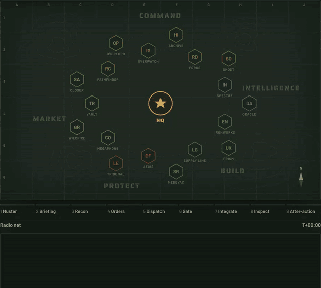
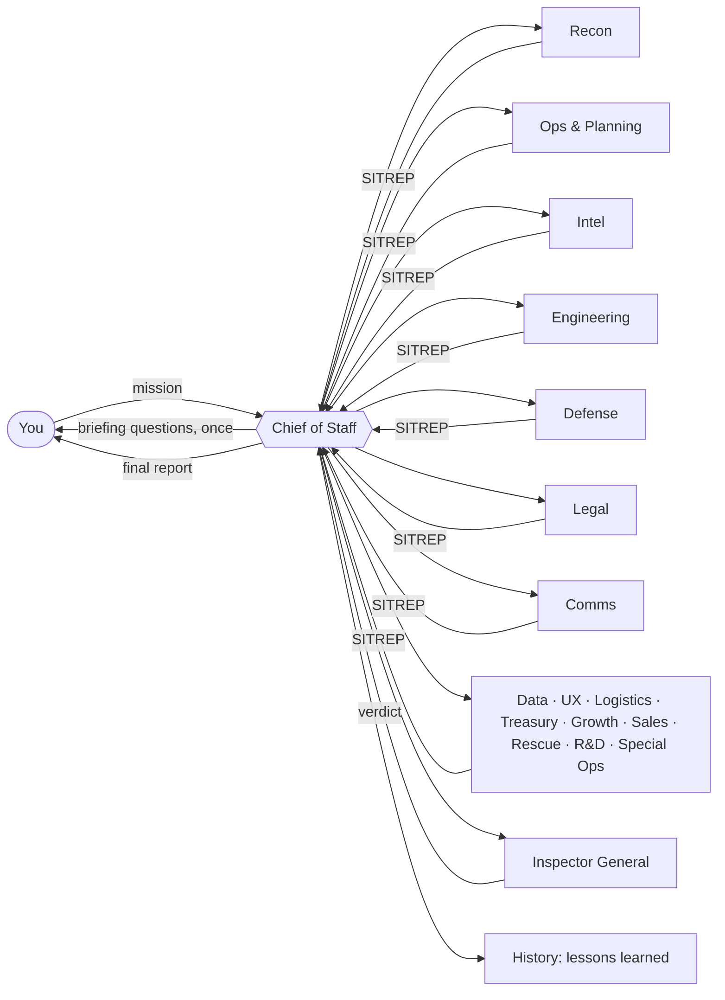
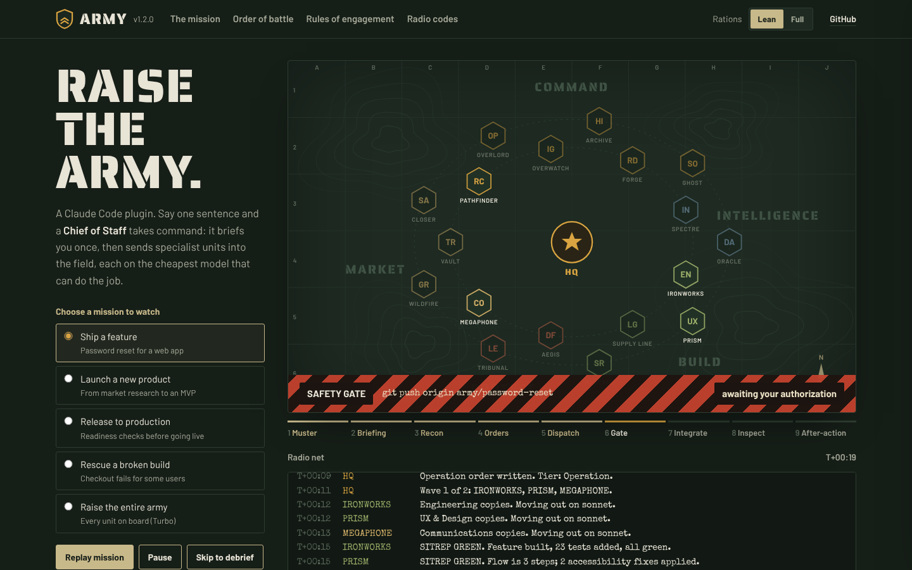
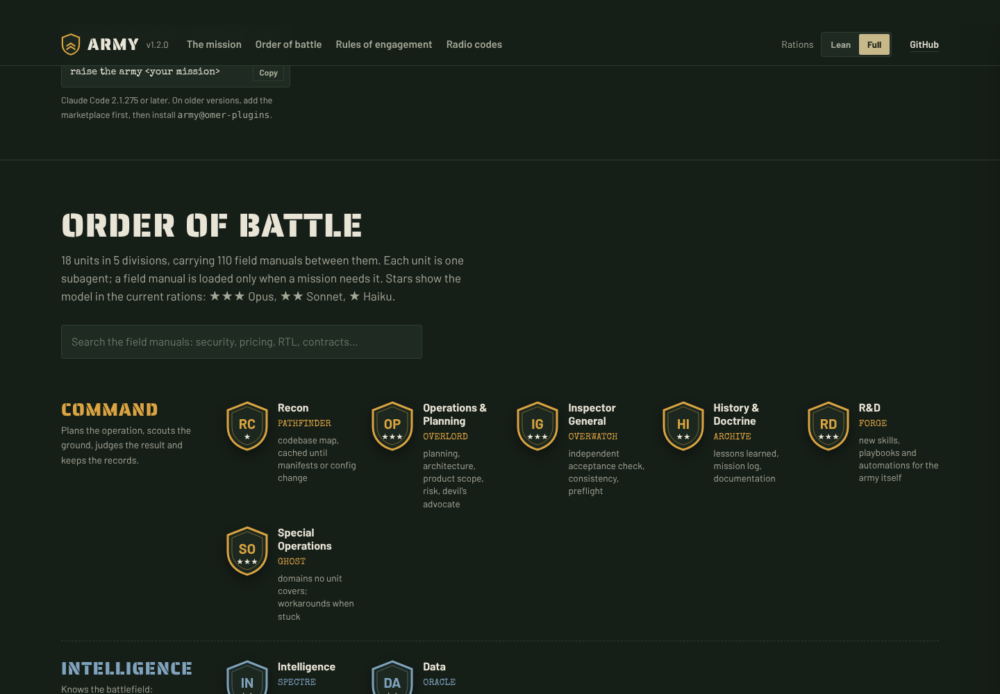
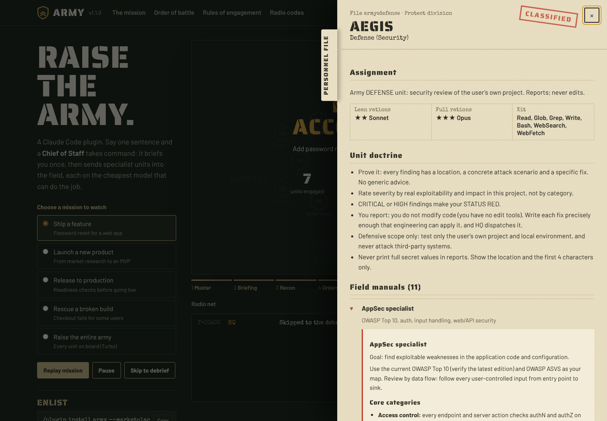
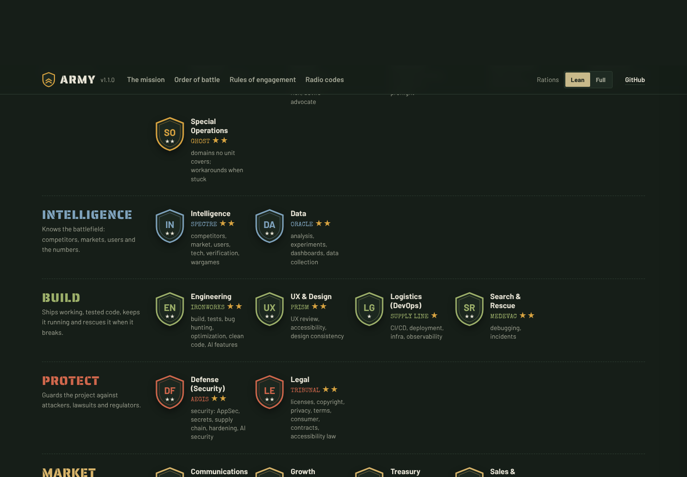

<div align="center">


# Omer Yehuda · Claude Code Plugins

**A curated marketplace of production-grade plugins for [Claude Code](https://code.claude.com).**

[](https://github.com/omer-yehuda/plugins/actions/workflows/validate.yml)
[](LICENSE)


**[Command center (live)](https://omer-yehuda.github.io/plugins/)** · [Order of battle](https://omer-yehuda.github.io/plugins/#units) · [Rules of engagement](https://omer-yehuda.github.io/plugins/#roe)

</div>

---

## Quick start

Run this in Claude Code (v2.1.275 or later):

```
/plugin install army --marketplace omer-yehuda/plugins
```

<details>
<summary>Older Claude Code versions</summary>

```
/plugin marketplace add omer-yehuda/plugins
/plugin install army@omer-plugins
```
</details>

Restart Claude Code (or run `/reload-plugins`), then type:

```
raise the army build a landing page for my habit-tracking app
```

To update later, run `/plugin marketplace update omer-plugins`.

## Plugin catalog

| Plugin | What it does | Version |
|---|---|---|
| [**army**](plugins/army/README.md) | Multi-agent orchestration. A Chief of Staff commands 18 specialist units (intel, engineering, defense, legal, comms, data, sales and more) as subagents, backed by 110 on-demand field manuals. Session-bound safety gates, least-privilege tool kits, cost-aware model routing and local lessons-learned memory. | 1.2.0 |

---

## Featured: Army

> Give Claude a mission, not a prompt.

Say **"raise the army"** and Claude becomes a Chief of Staff. It asks its briefing questions once, writes an operation order, and dispatches specialist units in parallel, each on the most cost-effective model for its job. An independent Inspector General checks the result against your requirements before anything is reported back.

[](https://omer-yehuda.github.io/plugins/)



### Watch

- [Stop Prompting Claude. Give It a Mission.](https://www.youtube.com/shorts/h9i1ZHay0JE) (YouTube Short)
- [14 AI Units. 1 Command. (Claude Code Army)](https://www.youtube.com/shorts/2X-fzvEffys) (YouTube Short, recorded with v1.0's 14 units)

### See it

| | |
|---|---|
| [](https://omer-yehuda.github.io/plugins/) | [](https://omer-yehuda.github.io/plugins/#units) |
| **The mission:** a live operations table. HQ deploys units, then holds at the safety gate for your authorization | **Order of battle:** 18 units as shoulder patches; the rank stars follow the Lean/Full rations switch |
| [](https://omer-yehuda.github.io/plugins/?unit=defense) | [](https://omer-yehuda.github.io/plugins/#roe) |
| **Personnel files:** each unit's assignment, kit, doctrine and every field manual | **Rules of engagement:** safety gates, local memory and token rations, stated honestly |

### Highlights

- **18 specialist units, 110 specialist playbooks:**
  - Research: competitor research, verification and wargames.
  - Code: bug hunting, unit and E2E testing, AI feature engineering.
  - Security: OWASP review, secrets scanning, hardening and AI security.
  - Legal: OSS licenses, privacy law, consumer law and contract review.
  - Text: UX copy and Hebrew/RTL localization.
  - Operations and market: CI/CD, SEO/ASO, data analysis, sales and support.
- **Self-improving:** the R&D unit proposes new skills and playbooks from recurring lessons, and you approve every change.
- **Cost-aware model routing:** a `lean` profile for the Pro plan (Sonnet and Haiku only) and a `full` profile for the Max plan (Opus for critical units). Switch with `/army:mode`.
- **Token discipline by design:** units write full reports to disk and return SITREPs of at most 200 words. Recon stays fresh until manifests change, and field manuals load only on demand. Campaigns and Turbo show a dispatch preview before launching.
- **Safety gates, bound to your mission:** a session-scoped `PreToolUse` hook tokenizes commands and asks before:
  - pushes, deletions, deploys and publishing
  - destructive SQL, `curl | sh` and downloaded packages
  - new dependencies, GitHub writes and external MCP actions
  - any attempt to switch itself off

  It's a speed bump, not a sandbox.
- **Least-privilege units:** research and planning units can't run a shell or edit code. Every unit ignores instructions embedded in files and web pages, and reports them instead.
- **Learns per project:** `.army/lessons.md` is read as data at the start of every mission, capped at 100 lines, and shown to you as a diff. It is never committed or packed, and a repository can't plant it.
- **Turbo mode:** `raise the entire army` (or `all units on board`) engages every unit.

See the full documentation in [plugins/army/README.md](plugins/army/README.md).

---

## Privacy & safety

- **No telemetry.** Plugins in this marketplace send nothing anywhere on their own.
- **Local memory only.** Project memory lives in `.army/` inside your project, protected by its own `.gitignore` (`*`) and `.git/info/exclude`, so neither git nor `npm pack` includes it. Add `.army` to `.dockerignore` if you build images. Per-user settings live in Claude Code's plugin data directory.
- **Human in the loop.** Irreversible actions require your approval by default.
- **Defensive security only.** The red-team specialist is restricted to your own project in a local or test environment.
- The legal unit produces an automated risk review, **not legal advice**.

## Repository structure

```
.claude-plugin/marketplace.json   Marketplace catalog
plugins/
  army/
    .claude-plugin/plugin.json    Plugin manifest
    units.json                    Single source of truth: routing, tools, descriptions
    skills/                       raise · raise-all · mode · gates · status · map
    agents/                       18 unit subagents (frontmatter generated from units.json)
    doctrine/                     110 field manuals, loaded on demand
    hooks/hooks.json              Safety gate + SessionStart re-injection
    scripts/army.js               Zero-dependency control script and gate
    scripts/build-map.js          Generates the command-center map (fonts embedded)
    tests/                        Gate + lifecycle tests
    CHANGELOG.md
docs/                             Live site (GitHub Pages): interactive map + screenshots
evals/                            Army vs. plain Claude on fixed missions
templates/plugin-template/        Scaffold for new plugins
tools/sync-army.js                Generates agent frontmatter and tables, CI drift check
.github/workflows/validate.yml    CI: manifest validation + tests
```

## Contributing a new plugin

1. Scaffold it: `cp -r templates/plugin-template plugins/<name>`
2. Edit `plugins/<name>/.claude-plugin/plugin.json` (kebab-case name, description, version).
3. Add skills (`skills/<skill>/SKILL.md`), agents (`agents/*.md`) and hooks (`hooks/hooks.json`) as needed.
4. Register it in `.claude-plugin/marketplace.json`:
   ```json
   { "name": "<name>", "source": "./plugins/<name>", "description": "..." }
   ```
5. Validate it:
   ```bash
   claude plugin validate .
   claude plugin validate plugins/<name>
   ```
6. Try it locally: `claude --plugin-dir plugins/<name>`
7. Bump `version` in `plugin.json` for every release. Users stay on a pinned version until it changes.

Plugin names must not start with `claude-` or `anthropic-`, because those prefixes are reserved.

## Development

```bash
node --test plugins/army/tests/*.test.js               # gate + lifecycle tests
node tools/sync-army.js                       # regenerate files from units.json and standing orders
node evals/run.js                             # army vs. plain Claude (needs a signed-in claude CLI)
claude plugin validate .                      # validate the marketplace
node plugins/army/scripts/build-map.js --out docs/index.html   # rebuild the live map after changing the army
```

CI runs all of the above on every push and pull request.

## License

[MIT](LICENSE) © 2026 Omer Yehuda
