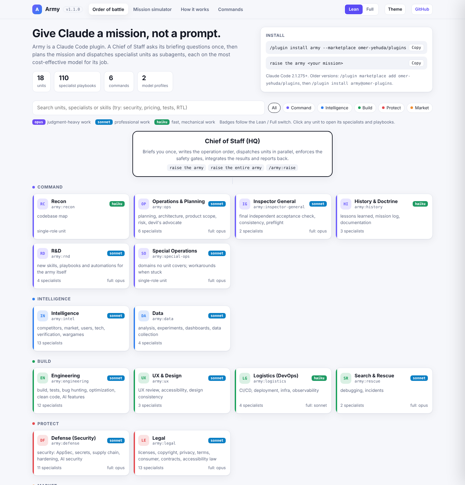

# Army: a chief of staff and specialist units for Claude Code

Say **"raise the army"** and Claude becomes a Chief of Staff (HQ). It asks you its briefing questions once, then plans the mission and dispatches specialist units as subagents, each on the most cost-effective model for its job. It runs to completion on its own, and stops only at the safety gates.

**[Explore the interactive map →](https://omer-yehuda.github.io/plugins/)** Browse every unit and read every playbook, try the mission simulator, and compare the Lean and Full model profiles.

[](https://omer-yehuda.github.io/plugins/)

## Install

```
/plugin install army --marketplace omer-yehuda/plugins
```

On Claude Code versions earlier than 2.1.275, run `/plugin marketplace add omer-yehuda/plugins` first, then `/plugin install army@omer-plugins`.

## Commands

| Say / run | What happens |
|---|---|
| `raise the army <mission>` · `/army:raise <mission>` | HQ engages only the units the mission needs |
| `raise the entire army <mission>` · `all units on board` · `/army:raise-all <mission>` | Turbo: every unit is engaged |
| `/army:mode lean` · `/army:mode full` | Switch model profile (lean = Pro-friendly, the default; full = Max) |
| `/army:gates on` · `/army:gates off` | Safety gates before irreversible actions (default: on) |
| `/army:status` | Mode, gates, active mission, memory size |
| `/army:map` | Generate the interactive army map locally (`.army/army-map.html`) |

You can also call a single unit directly: "send the defense unit to audit the auth flow".

## Order of battle: 18 units, 110 specialist playbooks

| Unit | Specialists | full | lean |
|---|---|---|---|
| **HQ** (`raise`) | Chief of Staff: briefing, intent, operation order, dispatch, integration | main session | main session |
| `recon` | Codebase mapping, cached per commit | haiku | haiku |
| `ops` | Mission planner, architect, product manager, risk analyst, devil's advocate, innovation | opus | sonnet |
| `intel` | Competitors, market, audience, tech scout, strategist, verifier, case studies, watch, due diligence, keywords, grants, user research, wargame | sonnet | sonnet |
| `data` | Analyst, experiments & statistics, dashboards, data collector | sonnet | sonnet |
| `comms` | UX copy, marketing copy, localization (Hebrew/RTL), plain language, proofreader, brand voice, outreach, review responder, press releases, video scripts | sonnet | sonnet |
| `engineering` | Builder, test strategist, unit tests, optimizer, clean code, dependencies, bug hunter, QA explorer, compatibility, AI engineer, integrations, mobile | sonnet | sonnet |
| `ux` | UX review, accessibility (WCAG 2.2), design consistency | sonnet | sonnet |
| `defense` | AppSec, secrets, supply chain, threat model, red team (own project only), hardening, AI security, personal-data mapping, child safety, backup & recovery, account security | opus | sonnet |
| `legal` | Licenses & copyright, privacy, terms & policies, accessibility law, trademarks, AI compliance, minors, consumer protection, advertising, defamation, contracts, disputes, platform terms | opus | sonnet |
| `logistics` | CI/CD, deployment, infra cost, observability | sonnet | haiku |
| `treasury` | Pricing & business model, cost forecast, cash-flow forecast, tax map, procurement, crowdfunding | sonnet | haiku |
| `growth` | SEO, ASO, launch, analytics, social, email, partnerships, conversion, paid ads, PR, community, reviews | sonnet | haiku |
| `sales` | Offers, B2B & institutional sales, negotiation, customer support, retention | sonnet | haiku |
| `rescue` | Debugging, incident response | opus | sonnet |
| `inspector-general` | Independent acceptance check, consistency checker, preflight checker | opus | sonnet |
| `history` | Lessons learned, mission log, documentation | haiku | haiku |
| `rnd` | Skill smith, playbook author, automation, proving ground (improves the army itself, with your approval) | opus | sonnet |
| `special-ops` | Missions in domains no unit covers; workarounds when the army is stuck | opus | sonnet |

**Why this structure:** in Claude Code, only the main session can launch subagents. So each unit is one subagent, and its specialists are playbooks (`doctrine/`) that the unit reads only when its brief needs them. Adding a specialist costs nothing until it is used.

## How HQ runs a mission

1. **Muster:** load the mode, the gates and this project's lessons.
2. **Briefing:** all questions in one round, then autonomous.
3. **Recon:** codebase map, cached per commit.
4. **Operation order:** commander's intent, definition of done, the units, the phases and the models. Missions are tiered:
   - An **operation** stays lightweight.
   - A **campaign** adds checkpoints after each phase, and runs on its own `army/<missionId>` branch.
5. **Dispatch:** independent units run in parallel. Every brief carries the intent.
6. **Safety gates:** irreversible actions wait for your approval.
7. **Integrate:** RED findings from defense or legal loop back for a fix. A unit that returns thin work gets one targeted re-brief.
8. **Inspection:** an Inspector General who never saw the work judges the result cold.
9. **After-action:** History updates the lessons, so the next mission starts smarter.

Try it in the [mission simulator](https://omer-yehuda.github.io/plugins/#simulator).

**Token savings built in:**
- Units write full reports to disk and return a SITREP of at most 200 words to HQ.
- Recon is cached per git commit, and the lessons file stays under ~100 lines.
- Lean mode routes heavy units to Sonnet and light ones to Haiku.
- Specialist playbooks load on demand.

Tip: in full mode, run the main session on Opus (`/model opus`), because HQ uses the main session's model.

## Memory (local only)

Each project gets a `.army/` folder:

```
.army/
  state.json        active mission flag (used by the safety gate)
  recon.md          codebase map, cached per commit
  lessons.md        lessons learned, read by HQ at the start of every mission
  missions/<id>/    operation order, unit reports, mission log
```

`.army/` is added to `.git/info/exclude` automatically. It is never committed and `.gitignore` is not touched. Your settings (mode, gates) are stored per user in the plugin's data directory.

## Safety gates

With gates **on** (the default), HQ asks before irreversible actions. During an active mission, a `PreToolUse` hook also enforces this for shell commands. It asks for approval before:

- `git push`, history rewrites and discarding changes
- deleting files
- deployments (Vercel, Netlify, Firebase, Fly, Kubernetes, Terraform, and more)
- publishing packages
- dropping data and running schema migrations
- installing new dependencies

Outside an army mission the hook does nothing.

## Requirements

Claude Code with plugin support, and Node.js 18+ (used by the control script, the hook and the map generator).
